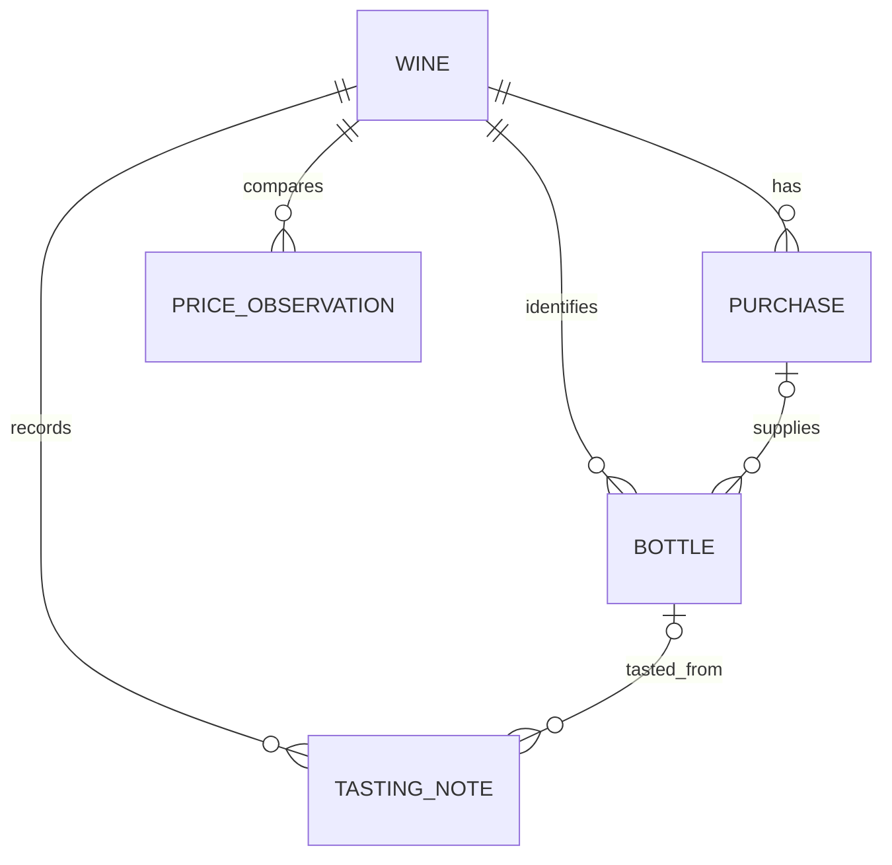

# P0 — 와인·구매·시음 관계와 데이터 보존 정책

결정일: **2026-11-10, Asia/Seoul** · 상태: **P0 설계 완료 / P1 저장·이전·보존 구현 및 자동 검증 완료**.

설계 출발점: `551d4a9`, DB v1. 현재 구현: DB v2. 이 문서는 지속 적용할 데이터 계약이며, 구현·남은 화면·검증 범위는 [프로젝트 계획서](project-plan.md#current-status)의 현황 표 참고.

## 결정 요약

| 대상 | 의미 | 핵심 결정 |
|---|---|---|
| Wine | 사용자가 식별한 와인 한 종류와 빈티지 | 구매·보유 여부와 독립; 동일 와인 선택을 통한 재사용 |
| Purchase | 같은 와인·용량을 한 번에 구매한 한 행의 이력 | 구매일·판매처·원래 수량·그 수량의 결제액 보관 |
| Bottle | 실제 병 한 개 | 와인에 필수 연결, 구매에는 선택 연결; 선물은 구매 없이 생성 |
| TastingNote | 한 번의 시음 경험 | 와인에 필수 연결, 병에는 선택 연결; 구매 없이 작성 가능 |
| PriceObservation | 특정 시점의 참고 가격 한 건 | 와인에 연결; 개인 구매 이력과 독립 |

보유 병수는 병의 상태에서 계산. 원래 구매 수량, 남은 병수, 시음 횟수는 각각 다른 값.

## 관계와 불변 조건

- 와인 한 건에 구매·병·노트·참고 가격 각각 0개 이상 연결 가능.
- 병 한 개의 `wineId`는 필수, `purchaseId`는 선택. 구매 연결이 없어도 보유 상태·보관 위치·사진 유지.
- 노트 한 개의 `wineId`는 필수, `bottleId`는 선택. `purchaseId`를 노트에 중복 저장하지 않는 구조.
- 구매와 연결한 병은 같은 `wineId`. 병과 연결한 노트도 같은 `wineId`.
- 구매 없는 시음: Wine + TastingNote만 생성. 가짜 Purchase나 Bottle 생성 금지.
- 구매 수량 N병 등록: Purchase 한 건과 Bottle N건을 하나의 DB 트랜잭션에서 생성.
- 병 하나에 노트 여러 건 허용. 시음 횟수 증가 자체로 병수를 차감하지 않는 규칙.
- 자동 저장·재시도·중복 탭으로 같은 병을 반복 차감하지 않도록 병 ID와 상태 변경을 기준으로 처리.

### 와인 동일성

식별 기준: 생산자 + 제품/큐베 이름 + 빈티지 구분. 사용자 저장소 안의 식별 기준이며 외부 서비스의 전역 ID를 요구하지 않는 구조.

- 같은 제품의 2020년과 2021년은 다른 Wine.
- 빈티지 미상과 실제 논빈티지(NV)는 다른 값. `vintageKind = year | nonVintage | unknown`, `vintage`는 `year`일 때만 정수.
- 용량은 Wine의 동일성을 나누지 않는 값. 750mL와 1,500mL는 같은 Wine에 연결 가능하지만 가격 비교에서는 별도 조건.
- 이름·생산자 등이 불완전한 임시 Wine 허용. 저장 시 최소 조건은 이름 또는 와인 사진 중 하나.
- 기존 와인 후보는 공백·대소문자·유니코드 정규화 등으로 제안 가능. 문자열 일치, OCR, AI 추측만으로 자동 병합 금지.
- 사용자가 기존 Wine을 고르면 해당 ID 재사용. 새 항목을 고르면 새 ID 생성.
- 초기에는 명시적 중복 병합 기능 보류. 기존 중복 ID와 관련 기록은 그대로 유지.
- 와인 정보 수정은 같은 Wine에 연결된 모든 화면에 반영. 다른 와인으로 바꾸거나 빈티지가 다른 기록을 합치는 작업은 일반 정보 수정과 구분하고 초기에는 미지원.

## 최소 데이터 계약

공통: 새 일반 기록은 UUID 기반 `id`, 시스템 기록 시각 `createdAt`·`updatedAt`. 기존 ID와 이전용 Purchase ID는 아래 이전 계약의 예외 적용. 과거 수정 시각이 없는 이전 데이터의 updatedAt은 null 허용; 새 기록은 생성 시 두 시각을 함께 저장. 사용자 사건 날짜와 시스템 기록 시각은 별도 의미.

### Wine

- `id`: 필수, 변경하지 않는 연결 기준.
- `name`, `producer`, `country`, `region`, `type`: 정보 미상 허용. 빈 문자열로 미상 값을 대신하지 않는 방향.
- `vintageKind`, `vintage`: 연도 / NV / 미상의 명시적 구분.
- `grapeVarieties`: 알려진 품종 목록; 모르면 빈 목록.
- `imagePath`: 구매 없이 저장한 라벨 사진의 선택 경로.
- `isWishlisted`, `isArchived`: 기본 false. 관심 여부는 보유·시음 여부와 독립.
- `name = null`인 경우 화면에서 이름 미확인 문구 표시. 이 문구 자체를 실제 와인 이름으로 저장하지 않는 규칙.

### Purchase

초기 단위: 같은 Wine·같은 용량·같은 구매 조건의 한 행. 여러 와인을 포함하는 영수증 전체나 주문 헤더는 후속 범위.

- `id`, `wineId`: 필수.
- `purchaseDate`, `shopName`: 선택. 구매 날짜나 판매처를 몰라도 저장 가능.
- `purchasedQuantity`: 양의 정수. 처음 구매한 수량이며 소비 후에도 유지.
- `totalPaidKrw`: 선택 정수, 0 이상이며 알 수 없으면 null. 해당 와인 행의 할인 반영 결제액이며 공동 배송비는 초기 계산에서 제외.
- `volumeMl`: 선택 양의 정수. 구매한 병의 용량을 모르면 null.
- `note`: 할인 조건·배송비 등 자유 메모. 자동 가격 정규화의 근거로 임의 해석하지 않는 값.
- 병당 구매가는 `totalPaidKrw / purchasedQuantity`로 계산. 반올림한 병당 금액을 별도 원본으로 저장하지 않는 규칙.
- 초기 통화는 KRW만 지원. 다른 통화의 숫자를 원화로 저장하거나 자동 환산하지 않는 범위.

구매 수량 변경은 기록 정정 동작. 연결된 모든 병 수보다 작은 수량은 저장 불가하며, 수량만 수정해 병을 암묵적으로 생성·삭제하지 않는 규칙. 새 구매의 최초 등록 시에만 N건의 병을 함께 생성. 기존 구매에 병을 추가 연결할 때도 연결 병 수는 구매 수량 이하.

기록된 구매액 합계는 남아 있는 Purchase의 알려진 결제액 합계. 미상 가격 건수는 별도 표시. 보유 병의 구매 원가는 inStock 병에 연결된 구매의 병당 금액 합계이며, 구매 연결·가격이 없는 병은 원가 미상으로 구분. 반품 상태만으로 원래 구매 수량·결제액을 변경하지 않으며 환불·순지출 계산은 후속 범위.

### Bottle

- `id`, `wineId`: 필수.
- `purchaseId`: 선택. 구매 삭제 시 null로 해제.
- `acquisitionKind`: `purchase | gift | other | unknown`. purchaseId가 있으면 purchase; 구매 연결 삭제 후에도 기존 취득 종류는 유지.
- `acquiredAt`: 선택. 실제로 병을 받은 날짜이며 구매일과 별개; 모르면 null.
- `volumeMl`: 선택. 구매 생성 시 구매의 용량을 복사해 병 자체에도 보존.
- `status`: `inStock | consumed | gifted | returned`.
- `statusChangedAt`: 선택. 과거 상태 변경 날짜를 모르면 null.
- `storageLocation`, `imagePath`: 선택.

구매의 용량 정정은 연결된 병의 용량도 같은 트랜잭션에서 갱신. 특정 병만 다른 용량으로 정정할 때는 기존 구매 연결을 해제하거나 올바른 별도 구매에 연결. 구매 삭제 후에도 병의 용량은 유지.

보유 병수: `status == inStock`인 병의 개수. 개봉 여부·남은 액량은 초기 범위에서 별도 모델링하지 않으며, 일부 시음만 했다면 보유 상태 유지.

2026-11-26 셀러 화면: 위 보유 병을 Wine ID별로 묶어 표시하고, 보관 위치·구매한 병 필터는 병 단위로 적용. 구매한 병의 판단은 acquisitionKind 기준이므로 구매 이력 삭제 후에도 보유 병은 유지. 금액은 표시 중인 병의 연결된 구매 단가 합계이며 미상 병 수는 별도 표시. 기록의 archive는 물리적 보관과 구분해 화면에 `기록 숨기기`로 표기.

상태 변경은 병 ID를 지정한 명시적 동작. inStock에서 다른 상태로 바뀌면 보유 수량 1 감소, 다른 상태에서 inStock으로 정정·복귀하면 1 증가. 보유 외 상태끼리의 정정은 수량 불변. 같은 상태로의 재요청은 수량·상태 변경일을 다시 바꾸지 않는 규칙. 사건 날짜는 사용자가 확인한 날짜를 사용하고 미상이면 null.

### TastingNote

- `id`, `wineId`: 필수.
- `bottleId`: 선택. 병 삭제 시 null로 해제.
- `tastedAt`: 선택. 날짜 미상을 허용하고 등록 시각으로 대체하지 않는 규칙.
- `rating`: 선택, 유한한 0~5 값. 미평가와 실제 0점 구분; 자동 4점 부여 금지.
- `aroma`, `palate`, `pairing`, `memo`, `imagePath`: 선택. 작성한 원문 보존.
- `acidity`, `tannin`, `body`, `sweetness`: 선택, 새 입력은 1~5 척도.
- `buyAgain`: `yes | no | unsure | null`. null은 아직 답하지 않은 상태.
- 노트의 최소 내용: 평점, 감상 텍스트, 사진, 재구매 의사, 세부 평가 중 하나 이상. Wine 선택만으로 빈 노트를 만들지 않는 규칙.

노트 작성·수정·삭제는 병 상태를 자동 변경하지 않는 동작. 사용자가 소비 처리와 노트 저장을 함께 선택한 경우에만 상태 변경과 노트 저장을 하나의 트랜잭션으로 처리. 이 결합 동작은 보유 중이거나 이미 소비한 병에 허용하며 선물·반품 상태의 정정은 별도 선택. 노트를 나중에 삭제해도 소비 상태 유지.

### PriceObservation

기존 필드·ID를 보존하고 `volumeMl`을 선택 필드로 추가하는 방향. 관측값은 구매 가격의 대체물이 아니며 구매 삭제와 무관하게 유지.

- 새 참고 가격은 유한한 양의 KRW 정수. 결제액 0원인 구매와 참고 가격은 별도 규칙.
- 기존 0원 관측치는 원본 보존을 위해 이전하되 비교 대상에서 제외하고 정정 필요 표시. 저장 제약은 0 이상, 신규·수정 입력 검증은 양수로 구분.
- 용량·빈티지 미상 자료도 보관 가능하되 비교 가능 여부를 별도로 표시.
- `Manual reference` 기존 관측치는 v1 이전 시 그대로 보존. 이후 구매 수정·삭제로 자동 교체·삭제하지 않는 독립 기록.
- 오래된 자료·재고·중복 출처·비교 임계값의 최종 계산 정책은 P4에서 결정.

### 미상 값과 날짜

| 상황 | 저장 기준 |
|---|---|
| 빈티지를 읽지 못함 | `vintageKind = unknown`, `vintage = null` |
| 라벨에 NV 명시 | `vintageKind = nonVintage`, `vintage = null` |
| 생산자·국가·종류를 모름 | 해당 값 null; 화면용 임시 문구와 실제 값 분리 |
| 구매가를 모름 | `totalPaidKrw = null`; 평균·총액 집계에서 미상 건수 별도 표시 |
| 실제 무료 구매 | 사용자가 확인한 0원; 미상과 구분 |
| 선물받은 병 | Bottle의 `acquisitionKind = gift`, `purchaseId = null`; 가짜 0원 구매 없음 |
| 구매일·시음일·취득일을 모름 | 해당 사건 날짜 null; `createdAt`은 실제 저장 시각 |

사건 날짜는 사용자 달력 날짜의 의미로 사용하되 초기 DB 저장형식은 기존 nullable DateTime 확장. v1 날짜 값은 기존 저장값 그대로 이전하고 시간대를 추측해 재해석하거나 현재 시각으로 치환하지 않는 규칙.

## 삭제·보관·연결 해제 정책

기본 원칙: 삭제 버튼의 대상만 삭제. 다른 대상의 이력은 유지하고 필요하면 연결만 해제. 전체 영구 삭제는 별도 명시적 동작.

| 사용자 동작 | 삭제·변경 대상 | 보존 대상 | 후속 처리 |
|---|---|---|---|
| 관심 해제 | `Wine.isWishlisted = false` | 와인·구매·병·노트·가격·사진 | 없음 |
| 와인 보관 | `Wine.isArchived = true` | 모든 원본 기록·사진 | 기본 목록에서 숨김, 보관 목록에서 복귀 가능 |
| 구매 기록 삭제 | 해당 Purchase 한 건 | Wine, 모든 Bottle·TastingNote·PriceObservation | 연결된 Bottle.purchaseId만 null; 보유 수량·상태 불변 |
| 병 기록 삭제 | 해당 Bottle 한 건 | Wine·Purchase·노트·참고 가격 | 연결된 TastingNote.bottleId만 null; 구매 원래 수량·금액 불변 |
| 시음 노트 삭제 | 해당 TastingNote 한 건 | 와인·구매·병·다른 노트·가격 | 병 상태 불변 |
| 참고 가격 삭제 | 해당 PriceObservation 한 건 | 와인·구매·병·노트·다른 가격 | 비교 결과 재계산 |
| 와인과 관련 기록 전체 영구 삭제 | 해당 Wine과 그 구매·병·노트·가격 전부 | 다른 Wine의 기록과 공유 참조 사진 | 영향 수량 확인 후 전체 DB 삭제, 참조 없는 사진만 정리 |

세부 동작:

- 재고가 있는 Wine의 보관은 차단. 병을 소비·선물·반품 처리한 뒤 보관하거나, 보유 상태에서 목록 필터만 변경.
- 보관된 Wine에 새 병을 추가하거나 기존 병을 inStock으로 복귀시키면 같은 트랜잭션에서 보관 해제. 일반 보유 목록과 실제 재고가 어긋나지 않는 규칙.
- 구매 삭제 안내에 보유 병수 유지와 구매일·구매처·금액 삭제를 함께 표시. 삭제한 구매 정보를 병·노트의 숨은 복사본으로 보존하지 않는 정책.
- 병 기록 삭제는 오등록 정리용. 마심·선물·반품은 병을 지우지 않고 상태로 남기는 사용 흐름.
- 병 삭제 후에도 노트의 와인·감상·날짜·사진 보존. 화면에는 특정 병 연결이 없는 시음으로 표시.
- 전체 영구 삭제는 구매 수·병 수·노트 수·가격 수와 정리 대상 사진을 미리 표시. 일반 보관 동작과 구분.
- 초기에는 휴지통·영구 삭제 취소 기능 미지원. 백업 파일은 별도 사본이며 앱 기록 삭제로 이미 내보낸 파일까지 변경하지 않는 범위.

### DB와 파일 처리 순서

1. 삭제할 행·해제할 연결·사진 후보를 계산하고 영향 범위 검증.
2. 행 변경과 연결 해제를 하나의 DB 트랜잭션으로 커밋. 실패 시 모든 행 변경 롤백.
3. 성공 후 사진 후보의 전체 참조를 다시 확인하고 앱 소유의 미참조 파일만 삭제.
4. 파일 정리 실패 시 DB 저장 성공은 유지하고 정리 재시도 대상으로 기록. 살아 있는 참조의 사진 삭제 금지.

초기 사진 참조 대상: `Wine.imagePath`, `Bottle.imagePath`, `TastingNote.imagePath`. 같은 파일을 둘 이상 참조할 수 있으므로 한 행 삭제만으로 파일 소유권 종료를 판단하지 않는 규칙.

사진 경로를 연결하는 쓰기와 정리 작업은 같은 직렬 실행 경로를 사용. 참조 확인과 파일 삭제 사이에 다른 저장이 같은 경로를 새로 연결하는 경쟁을 방지할 계약.

사진 교체 시 새 사진 복사 → DB 경로 갱신 → 미참조 이전 파일 정리. DB 실패 시 새 복사본만 미참조 여부 확인 후 정리. DB 마이그레이션 중에는 사진 파일을 삭제하거나 이동하지 않는 규칙.

### 관계 제약의 구현 계약

- Purchase·Bottle·TastingNote·PriceObservation의 필수 `wineId`: 외래 키, 부모 삭제 `RESTRICT`.
- Bottle의 선택 `purchaseId`: 부모 삭제 `SET NULL`.
- TastingNote의 선택 `bottleId`: 부모 삭제 `SET NULL`.
- 선택 연결의 같은 Wine 조건은 저장 서비스와 DB INSERT/UPDATE 트리거에서 검사. UI 검사만으로 보장하지 않는 구조.
- 구매별 연결 병 수 상한, 연결 병의 용량 일치(null 포함), 구매 연결과 acquisitionKind의 일관성도 저장 서비스와 DB 제약/트리거에서 검사. 용량 일괄 정정은 연결 해제 → 구매·병 값 정정 → 연결 복구를 한 트랜잭션에서 수행해 중간 제약 위반 방지.
- `SET NULL`은 선택 FK 하나에만 적용. 복합 FK를 사용해 필수 `wineId`까지 null로 만드는 설계 금지.
- Purchase·Bottle·TastingNote의 `wineId`는 초기 저장 후 일반 수정으로 변경하지 않는 계약. 관계 재배치·병합 기능은 후속 작업.
- 전체 영구 삭제는 서비스가 하위 행을 명시적으로 정리한 뒤 Wine 삭제. 일반 부모 삭제에 암묵적 연쇄 삭제를 걸지 않는 구조.
- DB 외래 키 검사와 같은 Wine 조건의 검사는 각 트랜잭션 완료 시에도 충족 필요.

## v1 → 다음 스키마 이전 계약

목표: 기존 ID·기록·사진 경로 보존. 구조를 바꾸면서 기존 중복 와인을 자동 합치지 않는 방향.

| v1 데이터 | 이전 규칙 |
|---|---|
| Wine | 기존 ID·알려진 필드·생성/수정 시각 보존. 빈 문자열은 미상 값으로 정규화; 원래 비어 있지 않은 텍스트는 보존 |
| 정수 vintage | `vintageKind = year`, 기존 연도 유지 |
| null vintage | `vintageKind = unknown`; 기존 UI의 NV 표시는 실제 NV 증거로 사용하지 않음 |
| Bottle 한 건 | 기존 Bottle ID 유지, 해당 병에서 Purchase 한 건 생성 |
| Bottle.purchaseDate / shopName / purchasePrice | 새 Purchase의 같은 날짜·판매처·`totalPaidKrw`로 이전; `purchasedQuantity = 1` |
| 새 Purchase ID | `legacy-purchase:<기존 bottleId>` 형태의 고정된 매핑. 새 일반 기록은 UUID 사용 |
| Bottle.isConsumed | false → inStock, true → consumed; 실제 소비일을 모르므로 statusChangedAt은 null |
| 새 Bottle 필드 | purchaseId 연결, acquisitionKind = purchase, acquiredAt·volumeMl은 null |
| Bottle 사진·보관 위치 | 기존 경로·위치 그대로 유지; Wine 사진으로 자동 이동하지 않음 |
| TastingNote | 기존 ID·wineId·bottleId·내용·평점·사건 날짜·사진·타임스탬프 보존; buyAgain은 null |
| PriceObservation | 기존 ID·필드·날짜·createdAt과 Manual reference 포함 전부 보존. v1에 없는 updatedAt과 volumeMl은 null; 기존 0원 관측치는 보존하되 비교 제외 |
| 새 Wine 상태 | isWishlisted·isArchived는 false; imagePath는 null |

이전 절차와 실패 처리:

- P1 구현: DB v2, v1·v2 Drift 스냅샷, 고정된 Schema2 기준 upgrade 단계와 실제 파일 DB 검증 포함.
- 저장을 중단한 일관된 DB 사본 또는 SQLite 백업 방식으로 이전 전 복구 지점 확보. 활성 WAL DB 파일 하나만 임의 복사하지 않는 원칙.
- 사전 검사: 외래 키, 병·노트의 Wine 일치, 새 제약을 위반할 기존 금액·평점·세부 평가 값 확인.
- 기존에 허용됐던 음수 금액·범위 밖 수치 등 발견 시 해당 행을 버리거나 값을 추측해 고치지 않고 이전 중단 및 원인 표시.
- 전체 스키마·행 변환은 트랜잭션 처리. 실패 시 기존 v1 데이터로 복귀하며 사진은 그대로 유지.
- 새 구매의 생성/수정 시각은 원래 Bottle의 시각 사용. 이전 실행 시각을 구매 사건 날짜로 사용하지 않는 규칙.
- 기존 Wine·Bottle·TastingNote·PriceObservation 개수·ID·내용·이미지 경로 일치 검사; 새 Purchase 수는 기존 Bottle 수와 일치.
- 기존 잘못 저장된 미소비 상태는 이력만으로 복원 불가. 체크 누락 문제 G-03을 추측으로 보정하지 않고 별도 수정 및 사용자 확인 대상.

## 예시와 검증 기준

2026-11-10: 아래 E-01~E-17의 저장·삭제·제약·사진·이전 기대 결과를 P1 자동 검사에 반영. 소비·시음 동시 입력은 저장소 검증이며 해당 결합 UI는 P3 범위. 근거: [정책 테스트](../test/database/domain_policy_test.dart), [이전·롤백 테스트](../test/drift/app_database/preservation_test.dart), [이미지 테스트](../test/miruvor_store_image_lifecycle_test.dart), [화면 테스트](../test/widget_test.dart).

| 사례 | 저장 결과 / 기대 결과 |
|---|---|
| E-01 와인바에서 한 잔 | W1 + N1, Purchase 0, Bottle 0; 구매가 없이 감상 조회 가능 |
| E-02 W1 세 병을 90,000원에 구매 | P1(quantity=3, total=90000), B1/B2/B3; 병당 30,000원, 보유 3병 |
| E-03 B1 소비와 N2 작성 | B1 consumed + N2.bottleId=B1; 보유 2병, P1.quantity는 3 |
| E-04 W1 두 병을 64,000원에 재구매 | 새 P2와 B4/B5; Wine W1 재사용, 총 보유 4병, 구매일·가격 각각 유지 |
| E-05 W1 한 병 선물받음 | 새 B6, acquisitionKind=gift, purchaseId=null; 구매 총액 불변 |
| E-06 P1 삭제 | B1/B2/B3는 유지, purchaseId=null; N1/N2·가격 유지, 보유 수량 불변 |
| E-07 B1 삭제 | N2.bottleId=null; N2의 감상·사진·W1 연결 유지 |
| E-08 N2 삭제 | B1이 남아 있다면 소비 상태 유지; 다른 노트 영향 없음 |
| E-09 같은 병 반복 시음 | B2에 N3/N4 연결; 별도 소비 선택 전까지 B2는 inStock |
| E-10 다른 Wine의 병을 노트에 연결 | 쓰기 거부, 기존 데이터 유지 |
| E-11 전체 Wine 영구 삭제 | 해당 와인의 하위 행만 제거; 다른 와인이 참조하는 사진 유지 |
| E-12 사진 공유·파일 정리 실패 | 살아 있는 참조 사진 보존; 미참조 정리 실패는 재시도 대상 |
| E-13 날짜·가격·평점 미상 | null 보존, 0원·0점·오늘 날짜로 둔갑하지 않음 |
| E-14 v1 이전 및 중간 실패 | 성공 시 원본 기록 보존; 실패 시 v1과 사진 보존, 부분 이전 없음 |
| E-15 B2 선물·반품 또는 상태 정정 | 보유에서 벗어나면 재고 1 감소; 구매 수량·금액·노트 유지, inStock 복귀 시 1 증가 |
| E-16 구매 연결 제약 위반 | 수량 상한 초과, 다른 용량, gift 병의 구매 연결을 거부; 전체 쓰기 롤백 |
| E-17 보관된 와인의 재입고 | 새 병 추가 또는 기존 병의 inStock 복귀 시 보관 해제, 재고와 목록 일치 |

E-06 이후에는 삭제한 구매액의 숨은 복사본으로 과거 총액을 재구성하지 않는 정책. E-07의 실제 병 삭제는 오등록 정리로 취급하고, 소비 이력 제거용으로 사용하지 않는 원칙.

## AI 입력 보조와의 경계

라벨 인식·메모 정리는 저장 전 초안 생성 기능으로 연결 가능. [API 연동 검토](api-integration-options.md) 참고.

- AI가 반환한 필드는 미확정 초안. 사용자가 확인한 값만 Wine·Purchase·TastingNote에 반영.
- 보이지 않는 빈티지·생산자·가격·취향을 추측해서 채우지 않는 기준.
- AI가 Wine ID를 생성·선택하거나 중복 기록을 자동 병합하지 않는 구조.
- 사용자 원문과 사진은 보존하고, AI 거절·오류·오프라인에서도 수동 저장 가능.
- AI 제안·신뢰도·출처 추적 DTO의 상세 스키마는 별도 실험 범위. P0의 null 허용과 독립 기록 구조를 사용.

## 확정 범위와 보류 사항

P0 확정: 엔티티 관계, Wine 식별 범위, 구매 금액·수량 의미, 미상 값, 병 상태, 삭제·보관 정책, 사진 참조 수명, 이전 기준, 대표 검증 사례.

P1 완료: Drift 테이블·인덱스·트리거, 미상 값·연결 검증, 독립 삭제, 사진 정리 큐, v1 이전과 복구 사본·롤백 검증. 전체 자동 테스트 42개 통과. [구현 구조](architecture.md) 참고.

후속 결정:

- P2: 빠른 입력과 세부 화면 배치, 후보 와인 선택 UI.
- P3: 특정 병 선택과 소비·시음 동시 입력 화면. 기본 상태 편집과 저장소의 원자적 소비·시음 저장은 P1 반영.
- P3 이후: 개봉·남은 액량, 상태 변경 전체 타임라인, 기록 병합·재배치.
- P4: 가격 비교의 자료 유효기간·표본 기준·조건 정규화와 여러 통화. 환불·순지출 회계도 별도 후속 범위.
- P5: 백업 포맷·복원 충돌 정책·휴지통 지원 여부.
- 별도 실험: AI 입력 보조용 서버·모델·사용량 제한과 실제 정확도.

P0는 설계 계약 완료, P1은 해당 저장·이전·보존 동작의 구현 및 자동 검증 완료. 2026-11-26 Android 서명 APK 빌드·정적 검증 추가. 실제 모바일 기기 이전·권한, 스토어·iOS 배포와 사용자용 사진 포함 백업·복원은 검증 범위 밖.
